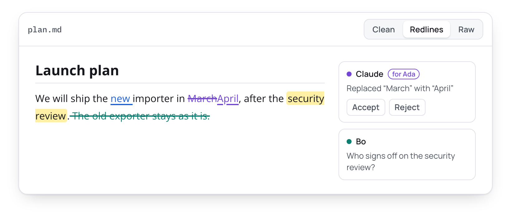
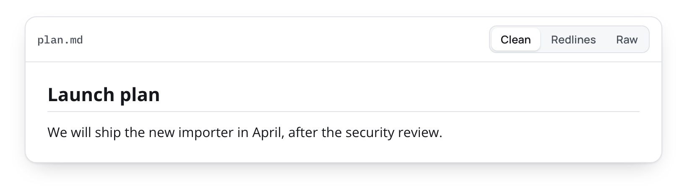
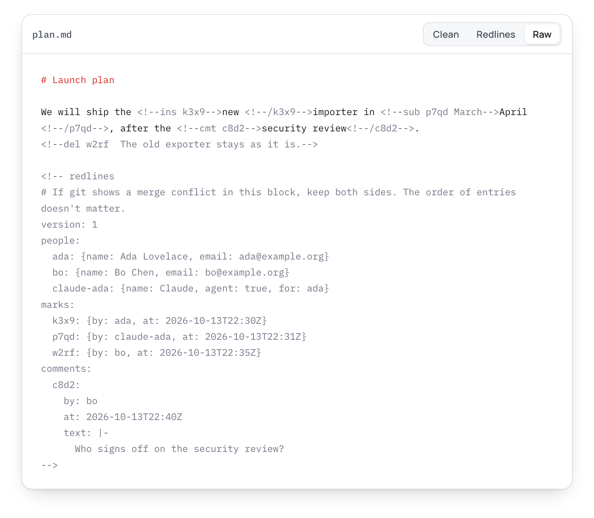

# Redlines

**A beautiful, free Markdown editor that shows every change.**

Status: design, October 2026. There is no app to download yet. This repository holds the design,
the file format, the research behind them, and the website.

1. **The most beautiful Markdown editor for Mac, Windows and Linux.** Free and open source. What
   you see is the document; Markdown syntax appears only where the caret is.
2. **Made for the documents AI writes.** Markdown is the document format of AI. Files from
   ChatGPT, Claude and agents open as beautifully rendered documents, not code, and copy and paste
   with Word, Google Docs and the web just work.
3. **See every change.** When a colleague or an AI edits your document, every change shows who
   made it, and you accept or reject it, like Track Changes in Word or Suggesting in Google Docs.
   It is all saved in the plain Markdown file.

## What a Redlines file looks like

The editor shows a document three ways. This is one short document in each.

**Redlines** shows who changed what. Ada added "new". Claude, working for Ada, replaced "March"
with "April". Bo deleted a sentence and asked a question. Each change can be accepted or rejected.

<picture>
  <source media="(prefers-color-scheme: dark)" srcset="docs/img/view-redlines-dark.png">
  
</picture>

**Clean** shows the document with every change accepted. GitHub, VS Code and other Markdown tools
show the same, because they hide HTML comments.

<picture>
  <source media="(prefers-color-scheme: dark)" srcset="docs/img/view-clean-dark.png">
  
</picture>

**Raw** shows the file itself. Each change is a short HTML comment with an id. Who made each change
and when, and the comment threads, are in a block at the end of the file.

<picture>
  <source media="(prefers-color-scheme: dark)" srcset="docs/img/view-raw-dark.png">
  
</picture>

## Read this first

- **[Design](docs/design.md):** what Redlines does and how it is built.
- **[Format](docs/format.md):** how tracked changes, comments and history are stored in a Markdown
  file.

The [research](docs/research/README.md) behind both, the [Word export](docs/word-export/README.md)
notes and the [website](website/README.md) are here too. Feedback is welcome as an issue or as a
comment on a pull request.

## License

[MIT](LICENSE).
