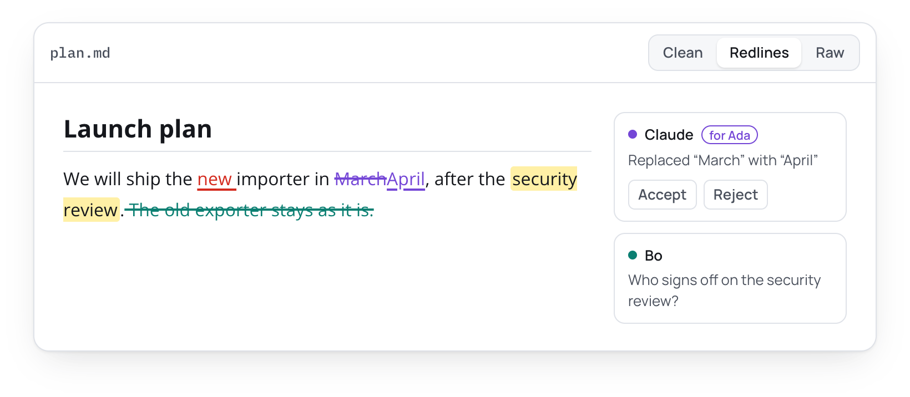
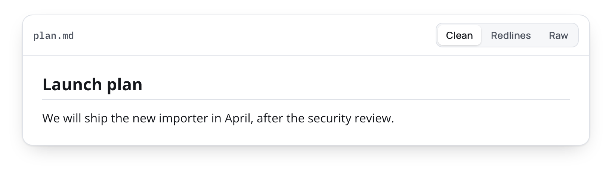
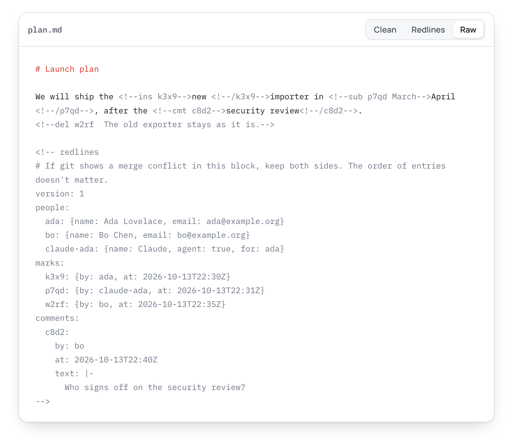
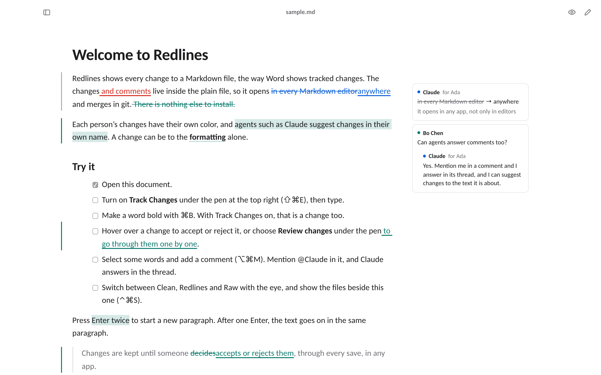

# Redlines

**A beautiful, free Markdown editor that shows every change.**

Status: November 2026. v0.2, version 0.2.0, is a signed, notarized Mac app that installs and
updates itself ([releasing](docs/releasing.md)). The Mac app also builds from source
([below](#run-it)). This repository holds the design, the file format, the
research behind them, the website, and the code: the format library, the editor, the review
interface, find, code blocks, agents, the command line and the desktop app.

1. **The most beautiful Markdown editor for Mac, Windows and Linux.** Free and open source. What
   you see is the document; Markdown syntax appears only where the caret is.
2. **Made for the documents AI writes.** Markdown is the document format of AI. Files from
   ChatGPT, Claude and agents open as beautifully rendered documents, not code, and copy and paste
   with Word, Google Docs and the web just work.
3. **See every change.** When a colleague or an AI edits your document, every change shows who
   made it, and you accept or reject it, like Track Changes in Word or Suggesting in Google Docs.
   It is all saved in the plain Markdown file.

## What a Redlines file looks like

The editor shows a document three ways. This is one short document in all three.

**Redlines** shows who changed what. Ada added "new". Claude, working for Ada, replaced "March"
with "April". Bo deleted a sentence and asked a question. Each change can be accepted or rejected.
A click on a change bar in the margin switches to Redlines' simple look, which reads like Clean, with
a bar beside each changed screen line and the comments kept; a click on a bar switches back.

<picture>
  <source media="(prefers-color-scheme: dark)" srcset="docs/img/view-redlines-dark.png">
  
</picture>

**Clean** shows the document with every change accepted. GitHub, VS Code and other Markdown tools
show the same, because they hide HTML comments.

<picture>
  <source media="(prefers-color-scheme: dark)" srcset="docs/img/view-clean-dark.png">
  
</picture>

**Raw** shows the file itself. Each change is a short HTML comment with an id. Who made each change
and when, and the comment threads, are in a block at the end of the file.

<picture>
  <source media="(prefers-color-scheme: dark)" srcset="docs/img/view-raw-dark.png">
  
</picture>

## What is in the Mac app

- **Writing.** Open, Open Recent, Save, Rename, Print and Reveal in Finder from the File menu.
  Find and Replace (⌘F, ⌥⌘F) works on the text you see, and with Track Changes on a replacement is
  a tracked change. ⌘= and ⌘- zoom the whole window, and a pinch or ⌃⌘= and ⌃⌘- the text alone. A file sidebar (⌃⌘S) lists
  the folders and documents of the document's project, its repository or else its folder. Plain
  text files (`.txt`) open and save as Markdown files do, and code blocks have syntax colors. Local
  images inside the project show in the document.
- **Preferences** (⌘,): your name and handle, themes, zoom and text size, the editor's habits, and the
  agents.
- **Agents.** Write `@Claude` or `@Codex` in a comment and post it, and that agent works on the
  thread: one gray line shows what it is doing (with Stop), then a short reply appears in the
  thread, and any change it makes is a tracked change in its name, for you to accept or reject. An
  agent is your own Claude Code or Codex, signed in the way you signed it in; Redlines never
  handles those credentials. Preferences › Agents shows each one's state, its version and where it
  is installed, and offers the next step: Update when it is too old, Sign In when it is signed out
  (each runs the agent's own command), or the command that installs it. A run that fails for one of
  those reasons says so in its line, which offers to open Preferences. The first time an agent runs
  in a folder it asks whether it may read the folder, or only the document, or, if Preferences
  allow it, the folder and your home folder (never hidden files and folders, or `~/Library` but
  its cloud folders). A document it cites,
  such as `plan.md:42`, opens at that line, and an image or a PDF in its default app.
  Every run writes a log, which Help › Show Agent Logs opens.
- **Quick Look.** Space on a Markdown file in Finder, Mail, Spotlight or the Open dialog shows it
  as the Clean view does: every change accepted, in the Default theme, under one line that says
  what is waiting in the file ("3 changes and 1 comment by Ada, Claude and Bo. Open in Redlines to
  review them."). R Markdown and Quarto files preview the same way, unless another app on the Mac
  declares those extensions as its own type, in which case macOS asks that app. It comes with the
  app and needs nothing installed (macOS 13.3 or later; System Settings › General › Login Items &
  Extensions › Quick Look turns it off); it draws no script, loads nothing and shows an image as
  its alt text.
- **The `redlines` command line** is inside the app, and needs no Node. Preferences › General ›
  Command line › Install links it at `/usr/local/bin/redlines`, so that it works in any new
  Terminal window. macOS asks for an administrator's password if that folder needs one; without
  one, it can go in `~/.local/bin` instead.

There is a short demo document in [docs/demo](docs/demo/line-endings.md).

## Run it

You need [Node](https://nodejs.org) 22 or later and pnpm 10.28.0 (`corepack enable` picks the
version in `package.json`). For the desktop app, also [Rust](https://rustup.rs) and, on a Mac, the
Xcode command line tools (`xcode-select --install`). From the root of a checkout:

```sh
pnpm install
```

**In a browser.** The quickest way to try the editor, with nothing native to build. Agents need
the app, because a browser can't start their programs:

```sh
pnpm --filter @redlines/desktop dev
```

Open <http://localhost:1420>. It shows the welcome document, `sample.md`, with an edit, a
suggestion, comments and an agent's change in it. You are Ada, one of its authors, and saving
keeps the file in memory.

**The desktop app, while working on it.** It opens with an empty document; File › Open (⌘O) opens
a Markdown file. Once in a new checkout, run `scripts/build-redlines` in `apps/desktop` first: it
builds the `redlines` program that the app carries, which Rust's `cargo` needs to find. Then:

```sh
cd apps/desktop
pnpm tauri dev
```

**Build Redlines.app.**

```sh
cd apps/desktop
pnpm tauri build --bundles app
open src-tauri/target/release/bundle/macos/Redlines.app
```

To open a file in it from the terminal: `open -a /path/to/Redlines.app plan.md`. The app follows
the system's light or dark appearance, unless Redlines › Preferences › Appearance sets Light or
Dark; the same pane picks the theme. Its icon is a
red caret on warm paper, and while the app runs, its Dock icon shows another mark of the same
family, a different one at each launch; turning off Redlines › Preferences › General › Rotate the Dock
Icon keeps the caret. Redlines › About Redlines says which build it is: the version and, in parentheses, the
commit and the time it was built (`0.1.0-dev (1a2b3c4-20261101.1430)`); a release shows its version
and commit.

**Build the disk image.** After building Redlines.app, in `apps/desktop`:

```sh
scripts/make-dmg
```

It writes `src-tauri/target/release/bundle/dmg/Redlines_<version>_<arch>.dmg` (`--debug` packages
the debug build). The script needs Python 3, which comes with the Xcode command line tools; its
first run sets up ds_store, mac_alias and Pillow in `src-tauri/target/dmg-tools`. It checks the
image it built before it says it is done.

The image holds only Redlines, the window's picture and its layout, so its window shows Redlines and nothing
else, without a scroll bar, even in a Finder that shows hidden files: the app's icon on a white
page, circled in red pen, with "Double-click to install" under it. The window's background, the
circle and the line, is `src-tauri/dmg/background.tiff`, which `scripts/make-dmg` puts on the image
as `.background/background.tiff`; after a change to either, or to where the icon sits,
`scripts/make-dmg --background` draws it again (at 1x and 2x, and it checks that the circle clears
the icon and its name), and the image needs building again.

There is nothing to drag: double-click Redlines and it asks "Install Redlines in your Applications
folder?" in a small window with two buttons to press, Not Now and Install, and no window buttons
(Return is Install, and Escape is Not Now). It installs itself in the Applications folder in your
home folder, or replaces the copy that is there already, or in /Applications where you can write.
Then it opens the installed copy and ejects the image. The installed copy is taken out of the
quarantine that a downloaded image's files carry, so macOS doesn't ask about it again, and it can
update itself. A release is signed and notarized; a build of your own isn't, and Gatekeeper stops
it on a downloaded image: allow it under System Settings › Privacy & Security, with Open Anyway.

<picture>
  <source media="(prefers-color-scheme: dark)" srcset="docs/img/v0.2/app-default-dark.png">
  
</picture>

**Releases** are built, signed, notarized and published by a workflow when a GitHub release is
published, and installed copies update themselves quietly: [docs/releasing.md](docs/releasing.md).

**Check your changes** as CI does: `pnpm typecheck && pnpm lint && pnpm test && pnpm format:check`.

## Claude Code

Inside the app, @Claude does this for you. From a terminal, Claude Code edits a Redlines file
through the `redlines` command line, so that each edit is a tracked suggestion in its own name, for
you to accept or reject. Give Claude the skill:

```sh
mkdir -p ~/.claude/skills/redlines
cp integrations/claude-code/SKILL.md ~/.claude/skills/redlines/SKILL.md
```

Install the command line from the app (Redlines › Preferences › General › Command line), then:

```sh
redlines view --review /path/to/plan.md
redlines str-replace /path/to/plan.md --old 'in March' --new 'in April' \
  --as claude-ada --name Claude --for ada --note 'The roadmap moved the launch'
```

In a checkout without the app, run it from the root as `pnpm -s redlines`, with the file's full
path, because pnpm runs from the root.

With the file open in Redlines, the suggestion shows up as soon as the command writes the file:
the app reloads a file that changed on disk, and keeps your unsaved edits if you have any. The
[integrations README](integrations/README.md) has an alias for running `redlines` from any folder.

## Read this first

- **[Design](docs/design.md):** what Redlines does and how it is built.
- **[Format](docs/format.md):** how tracked changes, comments and history are stored in a Markdown
  file.
- **[Releasing](docs/releasing.md):** how a release is built, signed and published, and how the app
  updates itself.

The [research](docs/research/README.md) behind both, the [Word export](docs/word-export/README.md)
notes and the [website](website/README.md) are here too. Feedback is welcome as an issue or as a
comment on a pull request.

## License

[MIT](LICENSE).
