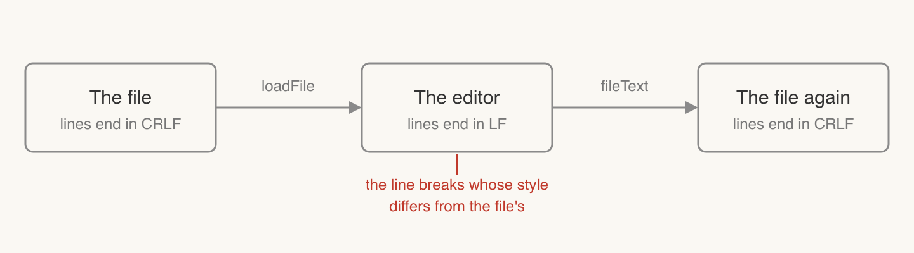

# Line endings

*A design note on how Redlines keeps a file's line endings. It is the document the demo opens.*

## 1. The question

A Markdown file written on Windows ends its lines with CRLF (`\r\n`). One written on a Mac or on Linux ends them with LF (`\n`). Some old files end them with a lone CR. When someone opens a file in Redlines and edits it, does it stay in the style it came in?

It does. A file that ends its lines in CRLF is still CRLF after an edit, and the diff shows only what the person changed. This note says how.



## 2. What the file promises

[docs/format.md](../format.md) §9.2 says a file changes only when its content does. Opening a file never writes it, and saving without edits leaves it byte for byte the same. Untouched parts are never reformatted, and that includes their line endings.

The editor holds the text as LF only, so positions are the same on every file. So the editor has to remember how each line broke, and put that back when it writes.

## 3. How the editor does it

When a file is loaded, `loadFile` splits it at every CRLF, CR and LF. It keeps three things:

| What                | Why                                                                         |
| ------------------- | --------------------------------------------------------------------------- |
| The text as given   | While nothing has changed, saving writes this string, byte for byte        |
| The file's line end | The style of its first line break, or LF if it has none                    |
| The odd breaks      | Each line break in another style, as a range that moves with the text       |

Saving, `fileText`, has three cases:

- The document is still the one that was loaded: it writes the text as given.
- The document changed and every line break had the file's style: it joins the lines with that style.
- The document changed and some breaks had another style: each break keeps its own, and a new one takes the file's.

A line break typed into a CRLF file is therefore written as CRLF. A file with mixed endings keeps its mixture. One case is handled on purpose: a lone CR followed by a lone LF would read back as one CRLF, so that CR is written as CRLF.

```ts
// packages/editor/src/line-breaks.ts
lineBreak ??= match[0];
if (match[0] !== lineBreak) breaks.push(new LineBreak(match[0]).range(pos, pos + 1));
```

## 4. Edits that don't come from typing

Agents and the command line don't go through the editor's text. They use the format library, which works on the file's own text, and it matches the file there too:

- `suggestReplace` writes the old and new text in the file's line ending before it looks for the old text, so an agent that sends LF finds its quote in a CRLF file.
- Accepting and rejecting write restored text in the file's line ending.
- The ledger at the end of the file is written in the file's line ending.

The file's line ending for these is CRLF if the file has any CRLF, and LF otherwise. That is not always the editor's choice: in a file whose first line break is LF and which has a CRLF later, a line you type gets LF and the later CRLF stays as it was, while an agent's edit gets CRLF.

## 5. Where it is tested

`packages/editor/src/line-breaks.test.ts` opens a CRLF file and checks that it saves unchanged, and that a line break typed into it is written as CRLF. Mixed files are tested in the same file.
