# Tables and Copy for Word

Status: research notes, October 2026. How Redlines edits, tracks and stores tables, how Word and
Google Docs handle the same operations, and how Copy for Word and printing keep a document's look.

Rows and columns have to be added at any position, selected, moved and deleted as units, and each
of these operations has to be a tracked change that Word can read. A table copied into Word should
look almost exactly like the same table in the PDF export, and a printed table should stay readable
across pages. This page covers the table design, how tables are stored in the format, Copy for
Word, and printing.

## Method

- Google Docs: a new test document in Chrome on 2026-10-14, first in Editing mode and then in
  Suggesting mode, Google's track changes. Screenshots were taken at each step.
- Word: Word for Mac 16.112. HTML samples were pasted into new documents, with ⌘V and through
  Word's scripting interface, and each document was saved and its XML read back.
- The comparison of Word and Google Docs also draws on their documentation and release notes.

The code and data are in the project's lab, outside this repository.

## How Google Docs edits tables

Redlines takes its table interaction from Google Docs, so Google Docs was tested in both of its
modes.

### Editing mode

| What                         | How Google Docs does it                                                                                                                                                                                                             |
| ---------------------------- | ----------------------------------------------------------------------------------------------------------------------------------------------------------------------------------------------------------------------------------- |
| Controls on hover            | Hovering a row shows a small strip left of it: a drag grip, a pin ("Pin header up to this row") and a + ("Insert 1 row below"). A column gets a strip above it: grip, Sort table, + ("Insert 1 column right")                       |
| Clicking a grip              | Does nothing. Grips are for dragging only                                                                                                                                                                                           |
| Selecting                    | Dragging across cells selects whole cells, never text in reading order: a row, a column or a block. A small toolbar (AI, comment, reaction) appears next to the selection                                                           |
| Delete on a block            | Clears the text of every selected cell and keeps the rows and columns. Undo restores text and selection                                                                                                                             |
| Moving                       | Dragging a grip moves the row or column, to any position including the last                                                                                                                                                         |
| Right-click with a selection | The menu counts the selection: "Insert 2 rows above," "Insert 5 columns right," "Delete 2 rows." It also has Insert title row, Pin header, Merge cells, Sort table, Set column type, Distribute rows and columns, and Table options |

<p>
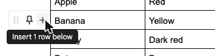
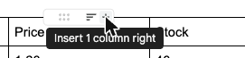
</p>

<p>
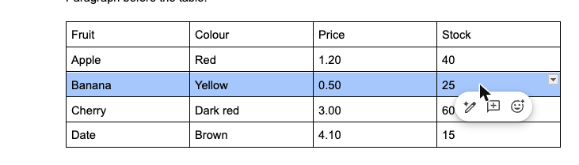
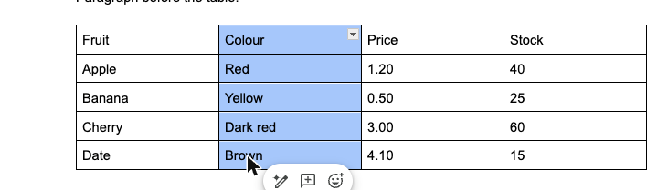
</p>

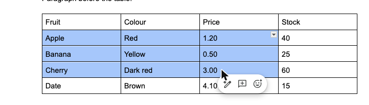

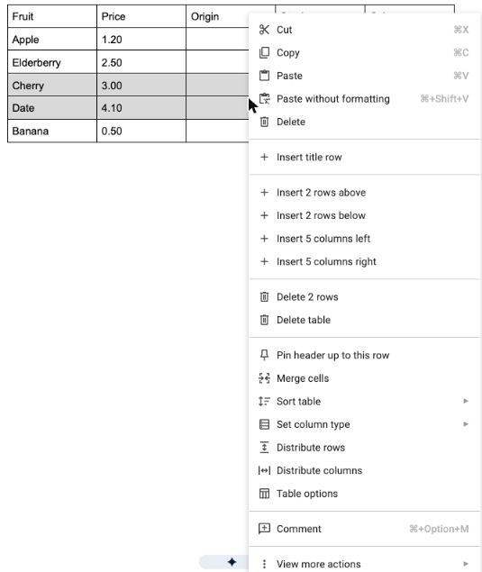

<p>
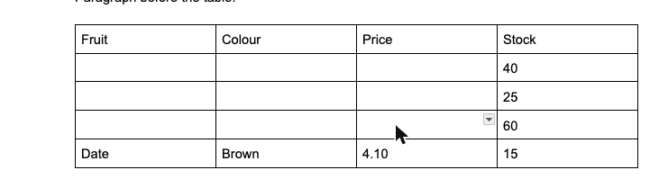
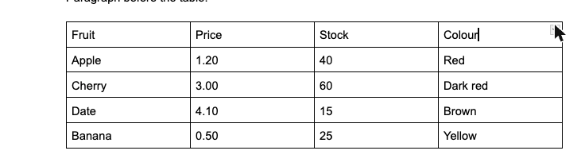
</p>

### Suggesting mode

- There are no hover strips. Rows and columns can't be dragged, inserted from a + or sorted, and a
  move can't be suggested at all. Inserting and deleting rows and columns still works from the
  right-click menu.
- Suggestions are shown in one color per author, green here:
  - a cell edit: the new text underlined and the old text struck through;
  - an inserted row: its text in green;
  - an inserted column: only its header text is green. Empty new cells show nothing, where Word
    tints them;
  - a deleted column: it stays in place, with its header struck through and a struck ¶ in each
    cell;
  - a cleared block: each cell's text struck through.
- Suggestions are listed as cards in the comments panel:
  - "Replace: '20' with '25'," "Add row: with text 'Fig 2.00'," "Delete column: with text
    'Origin'";
  - the cleared block is one card, listing a deletion per cell, accepted or rejected together;
  - each card has ✓ and ✗ on hover;
  - decided cards move to a Resolved section that records "Suggestion accepted" or "Suggestion
    rejected," who decided and when.

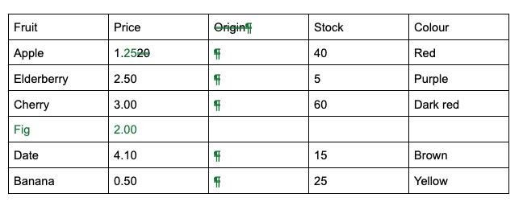

<p>
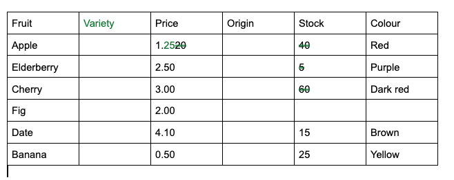
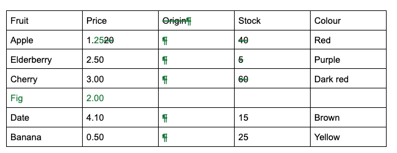
</p>

Google Docs tables can hold what a pipe table can't: merged cells, column types (dropdowns,
dates), pinned header rows beyond the first, and cell sizes. Redlines offers what a pipe table can
store. Sort and distribute are offered as operations; a sort becomes row moves.

What Redlines takes from Google Docs:

- Cell-based selection, Delete clearing every selected cell, and menus that count the selection.
- Hover strips per row and column, with a grip and a +. In Redlines a click on the grip also
  selects the row or column, which Google Docs doesn't do. That makes row and column selection
  easy to discover.
- One change for an operation on a block of cells.
- Decided suggestions kept in the thread history, as in the full-history design
  ([history.md](history.md)).

Redlines adds two things. Moves can be suggested, as a linked deletion and insertion. New empty
cells are tinted, as in Word, so a suggested empty row or column is visible.

## Word and Google Docs compared

| Product                       | Add rows and columns                 | Select rows, columns, blocks               | Move rows and columns                                        | Paste a range from a spreadsheet              |
| ----------------------------- | ------------------------------------ | ------------------------------------------ | ------------------------------------------------------------ | --------------------------------------------- |
| Word for Mac                  | Ribbon; select N rows to insert N    | Gridline and margin clicks; blocks by drag | Drag a selected row or column                                | Merges rows into the table                    |
| Word for the web, Google Docs | Hover + on row and column boundaries | Handles (Word for the web); drag           | Drag a handle; a blue line marks the drop (Word for the web) | From Sheets: linked or unlinked (Google Docs) |

- Word for the web and Google Docs show their controls on hover: a + on row and column boundaries,
  and a handle to drag.
- Neither Word nor Google Docs pastes a spreadsheet range into existing cells well. Word merges the
  rows into the table.
- Neither tracks table structure fully. Word doesn't track a column deletion, and Google Docs can't
  suggest a move.

## Table design

At rest a table shows no extra controls. They appear on hover, or while the caret is in the table,
in the margins outside it, so nothing shifts. While the caret is in a table, a toolbar above it
holds a size grid, alignment buttons and Delete Table.

- A ⋮⋮ grip appears in the left margin for the hovered row, and a ⋯ grip above each column. A
  click on a grip selects the row or column and opens its menu; a drag moves it.
- Within 8 px of a row or column boundary, a circled + appears in the margin, with a thin insertion
  line across the table. A click inserts a row or column there, at any position, not only at the
  end.
- There is one selection model: either a caret in a cell, or a rectangle of cells. Whole rows,
  whole columns and the whole table are rectangles that span it.
  - Dragging from one cell into another switches to cell selection.
  - ⇧-click extends the selection.
  - ⌘A selects the cell, then the table, then the document.
- During a drag the source dims, a ghost follows the pointer, and a 2 px line marks the drop at the
  nearest boundary, including after the last row or column. Esc cancels.
- Deleting is never silent. Removing a non-empty row or column needs a selection or an explicit
  command, and the size grid only adds. ⌫ on a selection first clears the cells, then a second ⌫
  removes the now-empty rows or columns.
- Every operation is one undo step and one tracked change, or a linked pair for a move.
- Source edits are minimal: whole lines for rows, one segment per line for columns, one delimiter
  cell for alignment. The table is never re-padded, because re-padding would turn every edit into
  a whole-table change.

### Keys

| Operation                  | Mac                         | Windows and Linux                               |
| -------------------------- | --------------------------- | ----------------------------------------------- |
| Insert table               | ⌥⌘T                         | Ctrl+T                                          |
| Insert row below / above   | ⌘↩ or ⌥⌘↓ / ⌥⌘↑             | Ctrl+Enter or Ctrl+Alt+↓ / ↑                    |
| Insert column left / right | ⌥⌘← / ⌥⌘→                   | Ctrl+Alt+← / →                                  |
| Select cell / row / column | ⌘E / ⌘L / ⇧⌥⌘↑              | Ctrl+E / Ctrl+L / Ctrl+Alt+Shift+↑              |
| Extend the selection       | ⇧+arrows                    | Shift+arrows                                    |
| Move row up / down         | ⌥↑ / ⌥↓                     | Alt+↑ / ↓                                       |
| Move column left / right   | ⌥← / ⌥→ with cells selected | Alt+← / → with cells selected                   |
| Delete rows / columns      | ⇧⌘⌫ / ⌥⇧⌘⌫                  | Ctrl+Shift+Backspace / Ctrl+Alt+Shift+Backspace |

All commands are also native menu items, so they can be rebound in System Settings.

### Tracked changes in tables

Tracked changes in tables use Word's vocabulary.

| Change                 | All Markup                                                                                                   | Simple Markup                         |
| ---------------------- | ------------------------------------------------------------------------------------------------------------ | ------------------------------------- |
| Row or column inserted | Cells tinted in the author's color, text underlined, change bar                                              | Normal cells, change bar              |
| Row or column deleted  | A ghost row or column, drawn from the deletion's payload: struck text, pink tint, not editable               | Hidden, change bar                    |
| Row or column moved    | Green double underline at the destination; a green struck ghost at the origin; accepted or rejected together | Destination only, bars at both places |
| Alignment changed      | No inline mark; a change bar and a card "Formatted: column _Key_ centered (was left)"                        | Change bar                            |
| Table deleted          | A ghost table; long ones collapse to a card "Deleted table (6 columns, 12 rows)"                             | Hidden, change bar                    |

### Pasting ranges

- Copying a block of cells writes plain text as tab-separated values, an HTML table, a Markdown
  sub-table, and a private Redlines flavor that keeps marks.
- Pasting spreadsheet cells:
  - at a caret, overwrites cells to the right and below, and grows the table;
  - onto a selection, fills exactly that rectangle;
  - on an empty line, makes a new table.
- A small chip offers _Overwrite cells · Insert as new rows · Paste as text in one cell_.
- Overwritten cells are tracked as substitutions and added rows and columns as insertions, and one
  group covers the whole paste.

## How tables are stored

The rules are in [format.md](../format.md#37-tables). Every operation above can be written with
them.

- An inserted row carries a marker at the start of its first cell, followed by one space:

  ```markdown
  | Fruit                     | Count |
  | ------------------------- | ----- |
  | Apples                    | 3     |
  | <!--ins k3x9 row--> Pears | 5     |
  ```

  The row's own text carries no other mark. An empty new row (⌘↩) is the marker alone in an
  otherwise empty row, so tables need no empty insertion segments. An inserted column carries a
  `col` marker in its header cell.

- Deleted rows and columns are removed from the table and kept in deletions after one blank line
  below it, with their position: `row=3`, or `col=2`. The header is row 0, body rows count from 1,
  and neither the delimiter row nor deleted rows are counted; columns count from 1. A deleted
  column keeps its delimiter cell, so its alignment comes back on reject.
- Pending marks inside a deleted row, column or table stay live, escaped in the payload
  (`<!-\-ins …-\->`). This is Word's model: a deleted row can contain someone's pending insertion.
  Rejecting the deletion restores them as pending.
- A move is a deletion at the old place and an insertion at the new one, linked by `move`, as for
  paragraphs. No new mark kind is needed.
- A mark that ends with a table closes after one blank line, like row deletions. A closer directly
  under the table rendered cleanly in all seven local renderers; the blank line is a safeguard for
  editors that turn a line under a table into a row.
- An alignment change is a format change on the table: `align=` with the old delimiter row.

The marker sits in the row because of the live-session and merge tests in
[collaboration.md](collaboration.md). An insertion in every cell lost rows in 9.2% of simulated
sessions of mixed table work, because it breaks once someone else types in the row. A marker below
the table with a position fixed that, but went stale in text merges, where it marks the wrong row.
The marker in the row lost no rows, and it survives text merges as well as the per-cell form,
because it travels with its row. In 400 git merges, the clean merges that were wrong (15 of 93)
had stale deletion positions: a reject would restore a row in the wrong place, but no text is
lost, and the merge driver recomputes the positions.

Exporting to Word:

- inserted and deleted rows map natively;
- an inserted column is marked as inserted cells (`w:cellIns`);
- for a deleted column, the exporter tries `w:cellDel`, which the standard defines but Word itself
  never writes. If Word can't accept or reject it, the column stays with its text as deleted runs,
  a comment on its header and a warning in the export dialog;
- an alignment change is a `w:pPrChange` on each cell's paragraph, not a `w:tblPrChange`, because
  GFM alignment is per column and Word stores alignment per paragraph (`w:jc`).

R Markdown and Quarto use pandoc's markdown reader, which gives a pipe table relative column widths
when any of its lines is longer than 72 characters. Markers in cells carry the author and time, so
they often push a row past that. The text is unchanged; only the column widths in HTML and Word
output change.

## Copy for Word

A copy pasted into Word should look almost exactly like the PDF export: the same fonts, monospace
code, tables within the margins, and headings that are still headings.

### Why copying a live editor goes wrong

When WebKit copies from a live editor, it puts its own serialization of the page on the clipboard,
with the computed styles written inline. A test document copied this way and pasted into a new
Word for Mac document, with Word's default paste, had three problems:

- Table text was in Times New Roman, while paragraphs and headings were in Open Sans, as in the
  editor.
- Code wasn't monospace anywhere: not inline, not in cells, not in the code block.
- Both tables ran past the right margin, and the wide table's last column was off the page.

The saved .docx shows the causes:

| In the clipboard HTML                                                                                    | What Word did                                                                                                       |
| -------------------------------------------------------------------------------------------------------- | ------------------------------------------------------------------------------------------------------------------- |
| Code styled with a CSS variable, `font-family: var(--monospace)`, which means nothing outside the editor | Stored `var(--monospace)` as the font name on 28 runs, and showed a fallback font                                   |
| Tables with `width: 800px`, the width of the editor's text column, and a pixel width on every cell       | Made every table a fixed 8.33 in wide, on a US Letter page with 6.5 in between the margins                          |
| The body font, Open Sans, from the editor's theme                                                        | Kept it. Word has Open Sans as an Office cloud font, so paragraphs and headings looked right                        |
| Table cells with no font of their own                                                                    | Gave them its HTML default, Times New Roman (114 runs)                                                              |
| Headings as `<h1>` and `<h2>` with inline styles                                                         | Applied direct formatting, not Word's Heading styles, so the Navigation Pane and a table of contents don't see them |

The clipboard also carried RTF, RTFD, a web archive and plain text. Word used the HTML.

### The design

- Generate the copy; never serialize the live editor. The copy comes from the same static renderer
  as the PDF, with one page setting (paper size and margins) shared by Print, Export and Copy, so
  the three never disagree.
- Write the clipboard natively, from Rust. WebKit rewrites any HTML that page JavaScript puts on
  the clipboard: it re-serializes inline styles and drops `<style>` blocks and `mso-*` properties.
  Tauri's own clipboard plugin wraps HTML and writes no RTF. The source code of WebKit and of the
  plugin shows both.
- Use one concrete font per element, never a CSS variable or a generic family alone, and set the
  font on every table cell. Word doesn't inherit fonts into cells: a font set only on the
  `<table>` gave Aptos, Word's default, in the cells.
- Give table widths in percent of the text width, measured once by the renderer for both the PDF
  and Word. No pixels anywhere.
- Write keep-with-next as `page-break-after: avoid`. Word ignores the modern `break-after: avoid`.
- Mark header rows and rows that shouldn't split with `<thead>` and `page-break-inside: avoid`.
  Word turns them into a repeating header row and "don't split" rows.

### Measured in Word for Mac

Nine samples were pasted through Word's scripting interface and the documents read back:

| Sample                              | Code font                           | Table cells            | Tables wider than the page     | Headings       |
| ----------------------------------- | ----------------------------------- | ---------------------- | ------------------------------ | -------------- |
| A live editor, copied by WebKit     | `var(--monospace)` (315 characters) | Aptos (Word's default) | All 5                          | Heading styles |
| A naive browser-style copy          | `var(--monospace)`                  | —                      | 1 of 2 (12.3 in wide)          | Heading styles |
| Word-tuned, inline styles           | Menlo                               | The set font           | None (100% and a 3.3 in table) | Heading styles |
| Word-tuned, Word's own HTML dialect | Menlo                               | The set font           | None                           | Heading styles |
| The Word-tuned copy as RTF only     | Menlo 12 pt                         | Times New Roman        | 1 of 2                         | None           |

- HTML wins over RTF when both are on the clipboard, and RTF loses the design. Redlines writes
  HTML, and RTF only for other apps such as Pages and TextEdit.
- Microsoft's font cloud has open-source monospace fonts. Pasting the font probes made Word
  download eight: Source Code Pro, IBM Plex Mono, Fira Code, Fira Mono, Roboto Mono, Inconsolata,
  DM Mono and Ubuntu Mono. Open Sans is there too. So Redlines can bundle Open Sans and one of
  these monospace fonts for the PDF, and Word will show the same fonts.
- Word takes the first installed family in a font list, and stores a missing or generic name as
  is: `monospace` became Courier New, while `ui-monospace` and `var(--monospace)` were kept as font
  names.

### Pasted with ⌘V

The scripting paste differs from ⌘V. The live editor's copy got Heading styles and Aptos cells by
script, but no Heading styles and Times New Roman cells by ⌘V. So the two Word-tuned samples were
pasted again with ⌘V on 2026-10-14:

| Sample                              | Code font | Table cells | Tables wider than the page | Headings                                                                                        |
| ----------------------------------- | --------- | ----------- | -------------------------- | ----------------------------------------------------------------------------------------------- |
| Word-tuned, inline styles           | Menlo     | Open Sans   | None                       | Outline levels and keep-with-next, but no Heading styles                                        |
| Word-tuned, Word's own HTML dialect | Menlo     | Open Sans   | None                       | Heading 1 and Heading 2, with keep-with-next; a "Redlines Code" style appears in Word's gallery |

Word's own HTML dialect is the format to use: Office namespaces, a `<style>` block that maps `h1`
and `h2` to Word's Heading styles, and named styles.

One gap remained: heading fonts. The headings took Word's own heading font (Aptos Display, 20 and
16 pt) instead of Open Sans, even when the heading text carried its font, size and color directly.
When pasted text uses a style the document already has, such as Heading 1, Word keeps its own
definition of that style.

### Heading styles

A second ⌘V on 2026-10-14, into a new blank document, settled the heading fonts:

| Headings in the HTML                                 | What Word made of them                                   | Look                                |
| ---------------------------------------------------- | -------------------------------------------------------- | ----------------------------------- |
| `h1`, `h2` mapped to Word's Heading 1 and 2          | Heading 1 and 2                                          | Word's: Aptos Display, 20 and 16 pt |
| "Redlines Heading 1" and "2," outline levels 1 and 2 | The new styles, outline levels 1 and 2, keep-with-next   | The PDF's: Open Sans, 22 and 17 pt  |
| The same styles, based on Word's Heading 1 and 2     | The new styles, based on Heading 1 and 2, keep-with-next | The PDF's: Open Sans, 22 and 17 pt  |

- Copy for Word uses "Redlines Heading N" styles based on Word's Heading styles. The PDF's look
  survives in a new document, and the headings stay headings: they inherit the outline level, so
  they appear in Word's Navigation Pane and its tables of contents. In a template, they also
  inherit what the template's Heading styles add, such as numbering, while keeping their own font
  and size.
- An option uses Word's own Heading styles instead, for pasting into a template whose heading look
  should win.

### Still open

- Word for Windows has defaulted to "Merge Formatting" for pastes from other programs since
  version 2405. That takes the destination's fonts, so the fonts there need their own test.
- Word for the web needs its own test too.
- Whether Word can accept and reject a column deletion written as `w:cellDel` is untested.

## Printing

- WebKit can't paginate tables well:
  - It doesn't repeat a table's header row on each page (WebKit bug 17205, open since 2008), and
    it can't keep rows whole (bug 82617).
  - Its PDF output ignores keep-with-next on headings (`break-after: avoid-page`). In a test
    export, a heading was left alone at the bottom of page 1 while its table started page 2.
  - On the Mac, WKWebView's print-to-file truncates on macOS 15 and 26.
- Chromium (WebView2 on Windows) repeats header rows and keeps rows whole, and it has margin boxes
  for page numbers.
- The recommendation is a small Redlines paginator over the static renderer, in a hidden
  page-width view. It works the same on WebKit, WebView2 and WebKitGTK. It:
  - measures the blocks;
  - fills fixed-size page boxes;
  - keeps headings with the next block;
  - splits tables only between rows, repeating the header row;
  - splits code blocks only between lines;
  - draws page numbers.

  Each page box is then written to PDF: WKWebView's `createPDF` plus PDFKit on the Mac,
  `PrintToPdf` on Windows. Printing prints that PDF.

- Wide tables step the font down to 90%, then 80%, then get a landscape page.
- Libraries to avoid:
  - paged.js: its header repetition isn't core, rows go missing, and its last release was in 2023;
  - Vivliostyle: it is AGPL-licensed.
