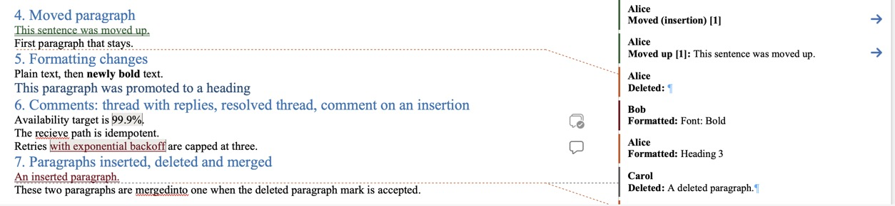

# Word lab: how Word stores and shows revisions

Status: findings, 2026-10-13. Part of the [design research](README.md).

Word is the reference for what track changes should do, so every hard case in the format was
re-run in real Word. This page records what Word for Mac stores and shows. It complements
[How Word displays Track Changes](../word-export/word-display.md), which was researched from
documentation and one sample file.

## Method

- Word for Mac (Microsoft 365, version 16.112.3), using local files only.
- The test documents were generated with the `docx` library, which the exporter plans to use.
  Some text in them is already marked as inserted by Ada or deleted by Bo. The local Word user,
  called SK below, then made the next edit with Track Changes on, so every scenario has several
  authors.
- The edits were driven through Word's AppleScript object model: Find on the selection, typing,
  `type backspace`, `type paragraph`, style and bold changes, table commands. This is the same
  path as typing and pressing keys, but repeatable.
- Each result was saved as .docx and its XML read back with a small dumper (`dump.py`). The
  display was checked in screenshots.
- The scripts (generators, AppleScript drivers and the dumper) are throwaway code, kept outside
  this repository so the runs can be repeated.

## Export and round-trip checks

The first check reopens the [sample .docx](../word-export/word-display.md#checked-in-word), whose
first version made Word report unreadable content. The second tests the carriers that the
[importer plan](../word-export/import.md#keeping-the-markdown-intact-on-a-round-trip) uses to keep
the Markdown intact.

| Question                                                       | Answer                                                                                                                                                                                                                                                                                                        |
| -------------------------------------------------------------- | ------------------------------------------------------------------------------------------------------------------------------------------------------------------------------------------------------------------------------------------------------------------------------------------------------------- |
| Does the fixed sample .docx open cleanly?                      | **Yes.** No "unreadable content" warning. Both halves of the move show: "Moved (insertion) [1]" at the destination, "Moved up [1]: …" at the source                                                                                                                                                           |
| Do a custom XML part and `_rl_` bookmarks survive a Word save? | **Yes.** After a tracked edit and a save, these all survive: `customXml/item1.xml` (content intact), a document variable (`w:docVar`), a custom document property, and the hidden `_rl_…` bookmarks. After Accept All, only the bookmark of the deleted paragraph is gone. Word for the web is still untested |
| Are likes saved in the .docx file?                             | **Yes.** A Like clicked in Word is saved in `commentsExtensible.xml` as `cr:reaction reactionType="1"` with the user's account id, display name and a UTC time to the second                                                                                                                                  |

## What Word stores for each edit

| #   | Edit (by SK)                                                      | What Word stores                                                                                                                                                                                                                              |
| --- | ----------------------------------------------------------------- | --------------------------------------------------------------------------------------------------------------------------------------------------------------------------------------------------------------------------------------------- |
| S01 | Type inside Ada's insertion                                       | Ada's insertion **splits** around SK's: `<ins Ada>shiny </ins><ins SK>and fast </ins><ins Ada>new </ins>`                                                                                                                                     |
| S02 | Delete part of Ada's insertion                                    | A deletion **nested in** the insertion: `<ins Ada>very <del SK>fast </del></ins>`                                                                                                                                                             |
| S03 | Delete across Ada's insertion and the text around it              | Three runs, each its own revision: `<del SK>ship </del><ins Ada><del SK>the new </del></ins><del SK>importer </del>`                                                                                                                          |
| S25 | Delete across Bo's pending deletion and Ada's insertion           | **Bo's deletion is re-attributed to SK**: `<del SK>Begin old </del>…`. Word loses who deleted "old"                                                                                                                                           |
| S18 | Type inside Bo's pending deletion                                 | The new text is **moved in front of the deletion**: `<ins SK>X</ins><del Bo>remove these words </del>`                                                                                                                                        |
| S07 | Delete from mid-paragraph 1, across a heading, to mid-paragraph 3 | Deleted runs in all three paragraphs plus **two deleted paragraph marks**. The heading also gets a tracked **style change, Heading 2 → Normal**, because the merged paragraph takes the **first** paragraph's style. Shown as **one** balloon |
| S08 | Backspace at the start of a paragraph                             | A deleted paragraph mark; displayed already joined, with a "Deleted: ¶" balloon                                                                                                                                                               |
| S09 | Backspace at the start of a heading that follows a paragraph      | Deleted ¶ plus a tracked style change **Heading 2 → Normal** ("Formatted: Normal")                                                                                                                                                            |
| S10 | Backspace at the start of a paragraph that follows a heading      | Deleted ¶ plus a tracked style change **Normal → Heading 2**. Rule: **a join takes the first block's type**                                                                                                                                   |
| S11 | Enter in the middle of a paragraph                                | An inserted paragraph mark on the first half                                                                                                                                                                                                  |
| S23 | Enter at the end of a paragraph, then type                        | The **previous** paragraph's mark is inserted; the new text is an insertion                                                                                                                                                                   |
| S14 | Delete a whole list item                                          | Deleted text and ¶. The balloon reads "Deleted: <#>S14 item two¶"                                                                                                                                                                             |
| S12 | Bold across Ada's pending insertion                               | A formatting change (`rPrChange`) on every run, inside Ada's insertion too                                                                                                                                                                    |
| S17 | Replace "fast" with "quick," then bold it                         | Smart-space logic took the trailing space too: `<del>fast </del><ins>quick </ins>`, and the new run carries a formatting change                                                                                                               |
| S13 | Change heading level; turn a paragraph into a heading             | A paragraph formatting change (`pPrChange`) holding the old style; balloon "Formatted: Heading 3"                                                                                                                                             |
| S15 | Table: edit a cell; insert a row; delete a row                    | Inline insertion; `w:trPr/w:ins` plus inserted cell text (row tinted blue); `w:trPr/w:del` plus deleted cell text (in balloon mode the row leaves the grid and becomes a "Deleted: cherry" balloon)                                           |
| S15 | Table: insert a column                                            | **Only a table-grid change.** No cell is marked as inserted                                                                                                                                                                                   |
| S15 | Table: delete a column                                            | **Not tracked at all.** The column vanishes. Reject All can't bring it back, and leaves the inserted empty column in place                                                                                                                    |

## Accept and reject

- Accept All gives the expected newest text. Joined paragraphs keep the first block's style.
- Reject All restores the original exactly, except the untracked column changes.
- Rejecting an insertion that contains someone else's deletion removes both.
- Rejecting a deletion nested in an insertion puts the text back inside the insertion.
- Rejecting an insertion that split someone else's merges their two halves back into one.
- Rejecting only the deleted ¶ of a join also undoes the style change that came with it. The
  two revisions are linked, not independent.
- Word merges adjacent revisions by the same author into one revision when it saves.
- Not tested: accepting one revision at a time. Word for Mac's AppleScript `accept` on a single
  revision behaves like `reject`, which looks like a Word bug. By the XML structure, accepting an
  insertion leaves a nested deletion pending.

## Comments on deleted text

| Case                                                                 | Word                                                                                                                                                               |
| -------------------------------------------------------------------- | ------------------------------------------------------------------------------------------------------------------------------------------------------------------ |
| All of a comment's text is deleted                                   | Word extends the deletion over the comment's reference mark, and **accepting it deletes the comment**. While pending, the thread disappears from the comments pane |
| A deletion covers the end of the range, but some of its text remains | Accepting still **deletes the comment**, because the reference mark went with the deletion                                                                         |
| Part of the text is deleted, not the end                             | The comment survives; its range shrinks to what's left                                                                                                             |

## Identity, ids and time

- Revision ids are not stable. Word renumbers every `w:id` (revisions, bookmarks, comments) on
  every save (101 became 9, then 8). Durable identity exists only for comments: the comment
  paragraph's `w14:paraId` and `w16cid:durableId`, random 8-hex-digit values that Word
  generates.
- `w:date` is local time with a misleading `Z`. For example, `w:date="2026-10-13T23:10:00Z"`
  next to `w16du:dateUtc="2026-10-14T03:10:00Z"`. Revision times have minute precision. Comment
  UTC times are in `commentsExtensible.xml`, and reactions have seconds. The importer must use
  the `dateUtc` attributes.
- Authors: revisions store only the display name (`Lastname, Firstname`). `people.xml` maps it to
  an account (`providerId="AD"`, `userId="S::<email>::<guid>"`).

## Comment threads

- A reply posted in Word gets:
  - its own comment, linked by `paraIdParent`;
  - its own random `durableId`;
  - **its own range markers over the same text, plus its own reference mark**.

  This confirms rule 4 of the exporter's
  [mapping rules](../word-export/README.md#mapping-rules-for-the-exporter).

- A reply written without its own range and reference mark is **silently dropped** on save. The
  lab generator did that by mistake.
- Files written by the `docx` library open in compatibility mode. The exporter should write
  `compatibilityMode` 15 so modern comments and likes work natively.

## What this means for the format

1. The inline model holds. Splitting, nesting a deletion in an insertion, and three-segment
   deletions are what Word does too.
2. Block breaks behave like characters, and a join takes the first block's type. The
   [format](../format.md) therefore lets one deletion cover a block break.
3. Redlines keeps more than Word in three places: who deleted already-deleted text, comments on
   deleted text (kept as [point comments](../format.md#4-comments)), and column changes. Export
   must degrade gracefully there, and import can't recover what Word has already discarded.
4. Ids: Word itself keeps random ids only for things that must survive edits and saves.
