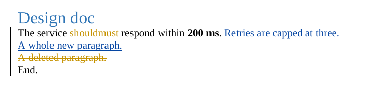

# Exporting Redlines to Word (.docx)

Status: research and recommendation, 2026-10-13. Nothing here is implemented
yet.

See also [How Word displays Track Changes in tricky cases](word-display.md),
the [Word importer plan](import.md) and the [Word lab](../research/word.md).

## Recommendation

Build the exporter in TypeScript on [`docx`](https://github.com/dolanmiu/docx)
(MIT, `npm i docx`, version 9.8 or later), as a new workspace package
`packages/docx`. It walks the parsed Markdown tree plus the marks from
`@redlines/format` and emits `docx` objects directly. Do not use
python-docx. Use pandoc as a test oracle, not as the exporter.

`docx` is the only TypeScript library found that writes every piece Word's
Track Changes needs, including threaded and resolved comments. None of the
existing Markdown-to-Word converters built on top of it expose those features,
so we write our own Markdown walker rather than extend one.

## What was checked

### `docx` (dolanmiu/docx) — writes everything we need

Verified with `docx@9.11.0` by generating a document and unzipping it (script
below):

| Redlines concept             | `docx` API                                                                                    | OOXML written                             |
| ---------------------------- | --------------------------------------------------------------------------------------------- | ----------------------------------------- |
| Insertion (inline)           | `new InsertedTextRun({id, author, date, text, …})`                                            | `<w:ins><w:r><w:t>`                       |
| Deletion (inline)            | `new DeletedTextRun({…})`                                                                     | `<w:del><w:r><w:delText>`                 |
| Substitution                 | adjacent `DeletedTextRun` + `InsertedTextRun`                                                 | `<w:del>` then `<w:ins>`                  |
| Inserted / deleted paragraph | `new Paragraph({run: {insertion \| deletion: {…}}})`                                          | `<w:pPr><w:rPr><w:ins/>` (paragraph mark) |
| Inserted / deleted table row | `InsertedTableRow`, `DeletedTableRow`                                                         | `<w:trPr><w:ins/>`                        |
| Comment                      | `comments: {children: [{id, author, date, …}]}` + `CommentRangeStart/End`, `CommentReference` | `comments.xml`                            |
| Comment reply (conversation) | `parentId` on the reply                                                                       | `commentsExtended.xml` `w15:paraIdParent` |
| Resolved thread              | `resolved: true`                                                                              | `w15:done="1"`                            |
| Stable comment id            | `durableId`                                                                                   | `commentsIds.xml`                         |
| Format change                | `revision` on run/paragraph properties                                                        | `<w:rPrChange>`, `<w:pPrChange>`          |
| Open with Track Changes on   | `features: {trackRevisions: true}`                                                            | `settings.xml` `<w:trackRevisions/>`      |

Reply threading (`parentId`, `resolved`) arrived in the 9.7–9.8 releases
(May–September 2026), so the dependency must be `^9.8`.

The generated file was checked two ways:

- pandoc (`pandoc --track-changes=all out.docx -t markdown`) reads back
  every insertion, deletion, paragraph insertion/deletion and comment, with
  authors and dates.
- LibreOffice renders the revisions per author with change bars:

  

This file was not opened in Microsoft Word, but the
[sample document](word-display.md), also written with `docx`, was. Word for
Mac shows its replies as a flat thread and hides its resolved thread from the
comments pane, leaving a check-mark icon in the margin. The
[Word lab](../research/word.md#comment-threads) adds two requirements: each
reply needs its own comment range and reference mark, or Word drops it on
save, and the exporter should write `compatibilityMode` 15, because files
written by `docx` open in compatibility mode.

### Markdown-to-Word converters in TypeScript — none support Track Changes

All of these sit on top of `docx`, and none emit `w:ins`, `w:del` or Word
comments (checked by searching their published code):

| Package                                                                   | License    | Notes                                                                           |
| ------------------------------------------------------------------------- | ---------- | ------------------------------------------------------------------------------- |
| [`remark-docx`](https://github.com/inokawa/remark-docx)                   | MIT        | unified/mdast plugin; pins `docx@9.7.1`; best reference for mapping mdast nodes |
| [`@mohtasham/md-to-docx`](https://github.com/MohtashamMurshid/md-to-docx) | MIT        | plugin API; its "comment" renderer only styles a paragraph                      |
| [`markdown-docx`](https://github.com/vace/markdown-docx)                  | MIT        | built on `marked`                                                               |
| [`mdast2docx` / `@m2d/core`](https://github.com/md2docx/mdast2docx)       | MPL-2.0    | plugin-based; copyleft per file                                                 |
| [`@adobe/helix-md2docx`](https://github.com/adobe/helix-md2docx)          | Apache-2.0 | tied to Adobe's Helix document model                                            |

Extending one of them would not help. Marks cut across Markdown structure (a
deletion that spans bold text and a link, a comment anchored across two
paragraphs, a whole inserted list item), so the exporter has to control how
runs are split and where paragraph marks are tracked. That is the core of the
exporter, and none of these packages offers a hook at that level. We can still
borrow `remark-docx`'s node-to-style mapping (headings, lists, tables, code,
images) as a reference.

### pandoc — works, but not TypeScript and no threads

pandoc's docx writer turns `[text]{.insertion author=… date=…}`,
`{.deletion}` and `{.comment-start}/{.comment-end}` spans into real tracked
changes and comments (verified with pandoc 3.1.3). It is a Haskell binary (a
~50 MB WebAssembly build exists as `pandoc-wasm`), it has no notion of reply
threads or resolved comments, and it only keeps comments that have a range.
That rules it out as the exporter, but it is a good **test oracle**: CI can
export a fixture, read it back with `pandoc --track-changes=all`, and compare.

The [pandoc filter](../format.md#11-the-pandoc-filter) for R Markdown and
Quarto uses the same writer, with the same limits. It serves the render
pipeline; full-fidelity Word files come from `packages/docx`.

### python-docx — no Track Changes

python-docx v1.2.0 (and the `skadauke/python-docx` fork, which has no commits
beyond it) supports adding comments (`Document.add_comment`,
`Run.mark_comment_range`) but has no API for replies, resolved state or
tracked insertions/deletions; those would have to be written as raw XML
through lxml. Using it would also put a Python service next to an otherwise
all-TypeScript stack, and the exporter could not run inside the editor or the
desktop app. Not recommended unless we later need to edit existing Word files
server-side in Python.

## Mapping rules for the exporter

These follow from how Word models revisions, not from the details of the
Redlines syntax:

1. **Run splitting.** Split text at every mark boundary and every inline
   formatting boundary, then wrap each run in insertion or deletion as needed.
   Formatting inside a tracked run (bold, italic, code) goes on that run.
2. **Paragraph marks.** An inserted paragraph tracks its paragraph mark as
   inserted. A deletion spanning paragraphs marks every paragraph mark except
   the last one as deleted, which is how Word merges paragraphs on accept.
   Inserted or deleted list items and table rows follow the same rule
   (`InsertedTableRow` / `DeletedTableRow` for rows).
3. **Substitutions** become a deletion immediately followed by an insertion,
   with the same author and date.
4. **Comment threads.** The first comment gets the range; each reply gets
   `parentId` of the first comment and the same range, which is what Word
   writes ([Word lab](../research/word.md#comment-threads)) and what pandoc
   needs to read replies back. A resolved thread sets `resolved` on the first
   comment.
5. **Ids.** Word revision and comment ids are integers unique per document.
   Keep a map from Redlines ids to Word ids, and derive `durableId` from the
   Redlines id so a later Word-to-Redlines import can match threads back up.
6. **Authors and dates.** Use the author's display name (falling back to the
   handle), with the `org` appended when two people share a name
   ([format.md](../format.md#10-word)). Initials come from the name. Use the
   mark's UTC time: the ledger's times have minute precision (`2026-10-13T22:30Z`),
   but `w:date` is an `xsd:dateTime`, which needs seconds, so write
   `2026-10-13T22:30:00Z`.
7. **Open with Track Changes on** (`trackRevisions: true`) so edits made in
   Word come back as revisions too.

## Proof of concept

The script used for the checks above (`npm i docx@^9.8`, then `node gen.mjs`):

```js
import fs from 'node:fs';
import {
  Document,
  Packer,
  Paragraph,
  TextRun,
  InsertedTextRun,
  DeletedTextRun,
  CommentRangeStart,
  CommentRangeEnd,
  CommentReference,
  HeadingLevel,
} from 'docx';

const A = 'Alice',
  B = 'Bob',
  d = '2026-10-13T12:00:00Z';
const doc = new Document({
  features: { trackRevisions: true },
  comments: {
    children: [
      {
        id: 0,
        author: A,
        initials: 'A',
        date: new Date(d),
        children: [new Paragraph('Is this the right latency budget?')],
      },
      {
        id: 1,
        author: B,
        initials: 'B',
        date: new Date(d),
        parentId: 0,
        children: [new Paragraph('Yes, agreed with infra.')],
      },
      {
        id: 2,
        author: B,
        initials: 'B',
        date: new Date(d),
        resolved: true,
        children: [new Paragraph('Resolved nit.')],
      },
    ],
  },
  sections: [
    {
      children: [
        new Paragraph({ heading: HeadingLevel.HEADING_1, children: [new TextRun('Design doc')] }),
        new Paragraph({
          children: [
            new TextRun('The service '),
            new DeletedTextRun({ id: 10, author: A, date: d, text: 'should' }),
            new InsertedTextRun({ id: 11, author: A, date: d, text: 'must' }),
            new TextRun(' respond within '),
            new CommentRangeStart(0),
            new CommentRangeStart(1),
            new TextRun({ text: '200 ms', bold: true }),
            new CommentRangeEnd(0),
            new CommentRangeEnd(1),
            new TextRun({ children: [new CommentReference(0)] }),
            new TextRun({ children: [new CommentReference(1)] }),
            new TextRun('.'),
            new InsertedTextRun({
              id: 12,
              author: B,
              date: d,
              text: ' Retries are capped at three.',
            }),
          ],
        }),
        new Paragraph({
          run: { insertion: { id: 13, author: B, date: d } },
          children: [
            new InsertedTextRun({ id: 14, author: B, date: d, text: 'A whole new paragraph.' }),
          ],
        }),
        new Paragraph({
          run: { deletion: { id: 15, author: A, date: d } },
          children: [
            new DeletedTextRun({ id: 16, author: A, date: d, text: 'A deleted paragraph.' }),
          ],
        }),
        new Paragraph({
          children: [
            new CommentRangeStart(2),
            new TextRun('End.'),
            new CommentRangeEnd(2),
            new TextRun({ children: [new CommentReference(2)] }),
          ],
        }),
      ],
    },
  ],
});
fs.writeFileSync('out.docx', await Packer.toBuffer(doc));
```

## Importing Word back

The importer has its own [plan](import.md), and it shapes the choices above.
mammoth.js and docx-preview ignore or only display revisions, so the importer
reads the OOXML itself (JSZip plus an XML parser): `w:ins`, `w:del`,
paragraph-mark revisions, `comments.xml`, `commentsExtended.xml` for threads
and `commentsIds.xml` for the durable ids written on export.
