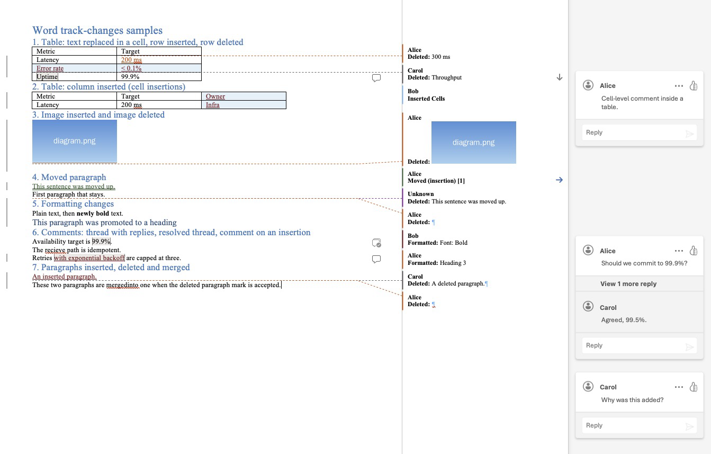
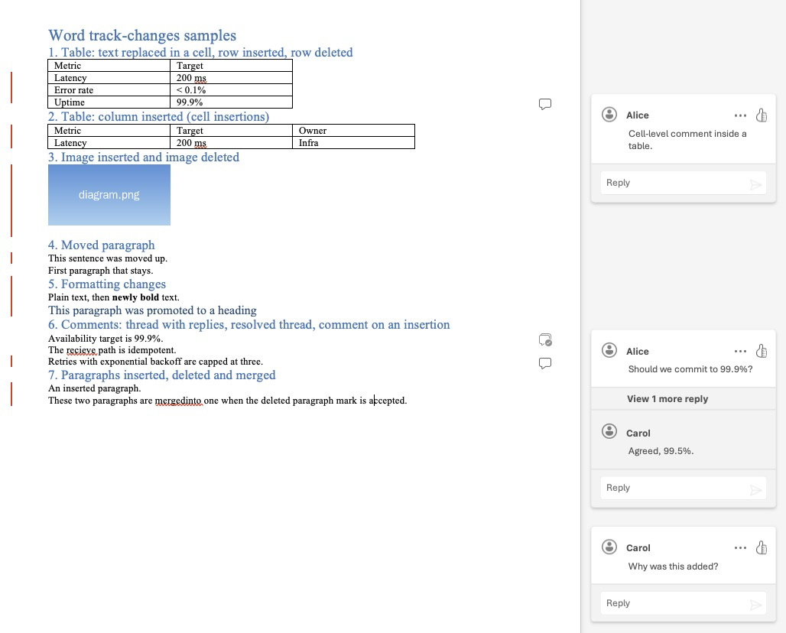
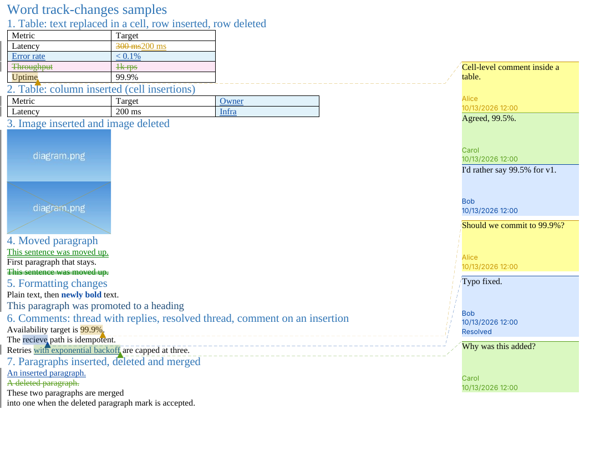

# How Word displays Track Changes in tricky cases

Status: research, 2026-10-13. This doc gathers what current Microsoft 365 Word
shows for each kind of revision and comment, the OOXML behind it, and what that
means for the Redlines format, the editor UI and the
[Word exporter](README.md).

Sources are Microsoft Support and Learn pages, Microsoft Q&A answers from MVPs
and Microsoft staff, the ECMA-376 and MS-OREACTXML specs, and Word
practitioners' write-ups. Claims marked **(inferred)** come from the schema or
common experience, not from a source we fetched. Claims marked **(Word)** were
checked in Word for Mac (Microsoft 365) on 2026-10-13 by opening the sample
document below; see [Checked in Word](#checked-in-word). The
[Word lab](../research/word.md) tested multi-author edits in Word for Mac and
records what Word stores in the XML for each.

We also rendered a sample .docx with every case below in LibreOffice 24.2
([`samples/track-changes-samples.docx`](samples/track-changes-samples.docx),
built by [`samples/generate.mjs`](samples/generate.mjs) and
[`samples/patch.py`](samples/patch.py)). The same file opened in Word for
Mac looks like this in All Markup and Simple Markup:

For comparison, LibreOffice 24.2 follows the same conventions but looks much
rougher, and shows comment replies out of order:

## Baseline: views, colors, bars and balloons

Word has four markup views
([Microsoft](https://support.microsoft.com/en-us/office/track-changes-in-word-197ba630-0f5f-4a8e-9a77-3712475e806a)):

| View       | What the reader sees                                                                   |
| ---------- | -------------------------------------------------------------------------------------- |
| Simple     | Text with changes applied, a **red** bar in the left margin next to changed lines      |
| All Markup | Insertions underlined, deletions struck through, per-author color, **gray** change bar |
| No Markup  | Text with changes applied, no marks                                                    |
| Original   | Text before the changes                                                                |

Clicking the change bar toggles Simple and All Markup
([Office Watch](https://office-watch.com/2013/markup-view-quick-switch-in-word-2013/)).

Balloons have three settings: all revisions in balloons, all inline, or only
formatting in balloons. In balloon mode, deletions move to the right margin
while insertions stay inline
([eiw365](https://eiw365.com/track-changes-inline-or-in-balloons/)).

Defaults from Advanced Track Changes Options
([Microsoft](https://support.microsoft.com/en-au/office/advanced-track-changes-options-in-word-2580cd04-1ea2-461b-98b3-c2f9c365f1f2)):

| Mark           | Default                                           |
| -------------- | ------------------------------------------------- |
| Insertions     | Underline, color by author                        |
| Deletions      | Strikethrough, color by author                    |
| Changed lines  | Bar at the outside border                         |
| Moved from     | Double strikethrough, green                       |
| Moved to       | Double underline, green                           |
| Inserted cells | Light blue shading                                |
| Deleted cells  | Pink shading                                      |
| Merged cells   | Light yellow shading                              |
| Split cells    | Light orange shading                              |
| Formatting     | No inline mark (inferred); balloon "Formatted: …" |
| Balloon margin | Right, with connector lines                       |

Author colors are assigned by each viewer's copy of Word and differ between
computers
([Microsoft](https://support.microsoft.com/en-us/office/change-the-track-changes-color-48c80bb3-458c-4abb-8e21-25f9bac47484)).
The file stores only `w:author` and `w:date` on each revision.

**For Redlines:** store author and timestamp, never colors. The editor
assigns author colors at view time, like Word. Offer Simple and All Markup as
the two main views; the clickable change bar is a cheap, recognizable way to
toggle between them.

## Tables

| Change                   | What Word shows                                                                                          | OOXML                                           |
| ------------------------ | -------------------------------------------------------------------------------------------------------- | ----------------------------------------------- |
| Text replaced in a cell  | Same as body text: struck-through old text, underlined new text                                          | `w:del` / `w:ins` runs in the cell              |
| Row inserted             | (Word) Row text underlined in the author's color, cells tinted light blue                                | `w:trPr/w:ins`                                  |
| Row deleted              | (Word) In balloon mode the row disappears from the table; a "Deleted: Throughput" balloon holds its text | `w:trPr/w:del`                                  |
| Cells inserted / deleted | (Word) Light blue / pink cell shading, plus an "Inserted Cells" balloon                                  | `w:tcPr/w:cellIns`, `w:cellDel`                 |
| Column deleted           | **Not tracked.** Word warns "This action won't be marked as a change"                                    | none                                            |
| Column inserted by hand  | (Word) Recorded only as a "Formatted Table" change; the new cells are not marked as inserted             | `w:tblPrChange`                                 |
| Column as `w:cellIns`    | (Word) The sample's column displays fine: light blue cells and an "Inserted Cells" balloon               | `w:cellIns` on each cell                        |
| Cells merged / split     | **Not tracked** since Word 2013 (warning dialog, cannot be suppressed)                                   | `w:cellMerge` exists but Word doesn't write it  |
| Table or cell properties | Balloon "Formatted Table" (inferred)                                                                     | `w:tblPrChange`, `w:trPrChange`, `w:tcPrChange` |

Sources: row and cell elements from ECMA-376
([trPr](https://webapp.docx4java.org/OnlineDemo/ecma376/WordML/trPr_1.html),
[tcPr](https://webapp.docx4java.org/OnlineDemo/ecma376/WordML/tcPr_1.html));
untracked column deletion and merges from Microsoft Q&A
([column](https://learn.microsoft.com/en-us/answers/questions/1161757/can-t-keep-track-of-changes-done-to-a-table-in-wor),
[merge](https://learn.microsoft.com/en-us/answers/a/10147163));
cell balloons in inline mode from
[Microsoft Q&A](https://learn.microsoft.com/en-us/answers/questions/5429008/inserted-cells-balloons-display-when-printed-despi).

A row-level insertion does not mark the cells' text; producers also wrap each
cell's text in `w:ins`
([Open XML docs](https://github.com/OfficeDev/open-xml-docs/blob/main/docs/word/how-to-accept-all-revisions-in-a-word-processing-document.md)).

**For Redlines:** Markdown tables are line-based, so an inserted or deleted
row maps directly to a tracked table row. Cell text edits are ordinary inline
marks inside a cell. Columns are the hard case: Word itself does not track
column deletion and records a column insertion only as a table formatting
change. Redlines tracks every change, including columns
([format.md](../format.md#37-tables)). The exporter writes a column change as
a set of inserted or deleted cells (`w:cellIns`/`w:cellDel`). Word displays
the inserted column in section 2 of the screenshot correctly; a deleted column
(`w:cellDel`) has not been tried in Word yet. Merged and split cells don't
exist in GFM tables (no colspan or rowspan), so that Word limitation never
arises; a table written as raw HTML is out of scope for cell-level tracking.

## Images and objects

- An inline picture behaves like a single character inside `w:ins` or `w:del`.
  An inserted picture gets an underline in the author's color under it; a
  deleted picture gets a strikethrough along the text baseline, near its bottom
  edge. Users find the two hard to tell apart
  ([Microsoft Q&A](https://learn.microsoft.com/en-us/answers/questions/0588f06c-b246-4c4d-a6fe-f69d3ae863f4/deletion-of-picture-using-track-changes?forum=msoffice-all)).
  No border or outline is added. (Word) In balloon mode, a deleted image moves
  out of the text into a "Deleted:" balloon that shows the picture, and an
  inserted one stays in place with an underline. LibreOffice draws a cross
  over a deleted image instead.
- Replacing a picture shows as delete plus insert (inferred).
- Resizing or cropping: (Word) not tracked at all. Markdown images have no
  size or crop, so this doesn't affect Redlines.
- SmartArt internals are not tracked; only replacing the whole object is
  ([Microsoft Q&A](https://learn.microsoft.com/en-us/answers/questions/4957127/smartart)).
- Text inside text boxes and equations are tracked like body text (inferred).

**For Redlines:** an image is `` text, so an inserted or
deleted image is an inline insertion or deletion of that text. The editor
should give tracked images a clearer marker than Word does: a colored outline
plus an "Inserted" or "Deleted" badge, with deleted images dimmed. Images are
atomic in the [format](../format.md): changing only the `src` or alt text is a
substitution of the whole image.

## Moves

- Moved-from text: green double strikethrough. Moved-to text: green double
  underline
  ([Microsoft](https://support.microsoft.com/en-au/office/advanced-track-changes-options-in-word-2580cd04-1ea2-461b-98b3-c2f9c365f1f2),
  [CyberText](https://cybertext.wordpress.com/2014/04/03/word-track-changes-moves/)).
- (Word) The destination balloon reads "Moved (insertion) [1]"; in the fixed
  sample, where the text moved up, the source balloon reads "Moved up [1]: …"
  ([Word lab](../research/word.md#export-and-round-trip-checks)). The first
  version of the sample wrote the source wrong (see
  [Checked in Word](#checked-in-word)).
- OOXML: `w:moveFromRangeStart`/`w:moveToRangeStart` sharing a `w:name`, with
  the text in `w:moveFrom`/`w:moveTo` and paragraph marks in
  `w:pPr/w:rPr/w:moveFrom|moveTo`.
- Word records a move only when at least a whole sentence is cut and pasted
  (or dragged) and has no pending changes. Shorter moves and copy-paste become
  delete plus insert, and users find move detection unreliable
  ([MVP thread](https://groups.google.com/g/microsoft.public.word.docmanagement/c/Rq2du-ii_SY)).

**For Redlines:** model a move as a deletion and an insertion linked by
`move` in the [ledger](../format.md#5-the-ledger). Readers who ignore the link
still see a correct delete and insert. The exporter turns linked pairs into
`w:moveFrom`/`w:moveTo`. The editor can detect moves on cut and paste of whole
blocks, which is more predictable than Word's sentence heuristic.

## Formatting changes

- OOXML: `w:rPrChange` (character formatting), `w:pPrChange` (paragraph
  properties, including style and list numbering), plus `sectPrChange`,
  `tblPrChange`, `trPrChange`, `tcPrChange`. Each holds the old properties and
  the author and date
  ([Open XML docs](https://github.com/OfficeDev/open-xml-docs/blob/main/docs/word/how-to-accept-all-revisions-in-a-word-processing-document.md)).
- In All Markup with default settings, formatting changes have **no inline
  mark**: only the change bar and a balloon. (Word) The balloons read
  "Formatted: Font: Bold" for a run and "Formatted: Heading 3" for a paragraph
  style change. Inline mode shows only the change bar unless a
  formatting mark is configured. Simple Markup shows only the red bar. Users
  often turn these balloons off because they are noisy
  ([Microsoft Q&A](https://learn.microsoft.com/en-us/answers/questions/4793593/unwanted-format-balloons-format-margin)).
- LibreOffice shows the new formatting in the author's color and nothing for a
  paragraph style change except the change bar (see the screenshot).

**For Redlines:** in Markdown, formatting is syntax (`**bold**`, `#`
for a heading, `-` for a list item). The simplest faithful model is a
substitution of the syntax characters, such as a deletion of `**` and an
insertion of `**` around the same text, but that reads badly. The format
instead has a [format change](../format.md#26-format-changes) mark that
records what changed ("was plain, now bold" or "was paragraph, now
heading 2"), and the exporter maps it to `w:rPrChange` or `w:pPrChange`. The
editor should show it like Word: a change bar plus a small "Formatted: Bold"
card, not inline decoration.

## Comments

**Modern comments** (Microsoft 365, since 2021)
([Microsoft](https://support.microsoft.com/en-us/word/using-modern-comments-in-word),
[Tech Community](https://techcommunity.microsoft.com/blog/microsoft_365blog/introducing-modern-comments-in-microsoft-word/2263182)):

- **Contextual view** (default): comment cards in a pane on the right, aligned
  with their anchors; the anchored text is highlighted. **Resolved threads are
  hidden** in this view.
- **List view**: all threads, resolved ones included, in a Comments pane.
  Reopening a resolved thread brings it back into the contextual view.
- A thread is a first comment plus a flat list of replies; there is no nesting
  beyond one level.
- Comments are drafted and then posted (Ctrl+Enter). You can't edit someone
  else's comment in the card.
- Comment text allows bold, italic, underline, strikethrough, color, highlight
  and images; no tables or equations.
- **@mentions** notify the person (cloud documents only) and can assign the
  comment as a task.
- **Resolve** is in the card's "…" menu; resolved comments are grayed out
  ([python-docx analysis](https://python-docx.readthedocs.io/en/latest/dev/analysis/features/comments.html)).
- (Word) Replies show as a flat thread under the first comment, collapsed
  behind "View 1 more reply" when there are several. The resolved thread is
  hidden from the pane and leaves a comment icon with a check mark in the
  margin. Every card has a Like button.
- **Like** (thumbs up) is the only reaction. A count shows next to the button
  and hovering lists who liked it
  ([Microsoft 365 Insider](https://insider.microsoft365.com/en-us/blog/react-to-comments-in-word-for-windows)).
  Word for iOS and Android cannot show reactions.

Comments are stored across five parts, each adding one thing
([python-docx analysis](https://python-docx.readthedocs.io/en/latest/dev/analysis/features/comments.html)):

| Part                     | Holds                                                             |
| ------------------------ | ----------------------------------------------------------------- |
| `comments.xml`           | Comment text, `w:author`, `w:initials`, `w:date`                  |
| `commentsExtended.xml`   | Reply parent (`w15:paraIdParent`) and resolved state (`w15:done`) |
| `commentsIds.xml`        | Durable id per comment                                            |
| `commentsExtensible.xml` | UTC date and extensions, including **Like reactions**             |
| `people.xml`             | Author identities                                                 |

Likes are stored in the file, not only in the cloud:
`w16cex:commentExtensible/…/cr:reactions/cr:reaction[@reactionType="1"]` with a
`cr:user` and UTC date per like (namespace
`http://schemas.microsoft.com/office/comments/2020/reactions`;
[MS-OREACTXML](https://learn.microsoft.com/en-us/openspecs/office_standards/ms-oreactxml/24d7d1f3-568d-4df9-89ef-42867776d742)).
Type 1 is "like"; no other type is defined. There is no thumbs-down.

A comment range starts and ends at run boundaries and is contiguous in
document order, so it cannot cover two vertically adjacent table cells. Word
never makes a zero-length comment; with no selection it anchors to the word
before the cursor. A comment inside a table cell is an ordinary range in that
cell. A comment over a tracked change interleaves its range markers with the
`w:ins`/`w:del` runs (inferred; it works in the sample).

**For Redlines:**

- Threads: first comment plus a flat list of replies, each with author and
  timestamp, and a `resolved` flag (with who resolved it and when, which Word
  does not keep but is cheap to store). This matches the format's
  [comment threads](../format.md#4-comments).
- Reactions: support "like" (author + timestamp) so it survives a round trip
  through Word. Other reactions, such as thumbs-down, can be stored in the
  Redlines format. Word has no equivalent, so the exporter writes them as
  likes ([format.md](../format.md#4-comments)).
- Mentions: store `@handle` in the comment text. Word only turns mentions into
  notifications for cloud documents, so the exporter keeps them as plain text.
- Display: follow modern comments, not classic balloons with connector lines:
  cards in a right-hand column aligned with their anchors, anchor highlighted,
  resolved threads hidden by default with a toggle to show them.
- Word comment ranges can't be empty, so the exporter anchors a point comment
  to the nearest surviving word ([format.md](../format.md#4-comments)).

## Paragraph-level changes

- An inserted or deleted paragraph mark is `w:pPr/w:rPr/w:ins` or `w:del`.
  Accepting a deleted paragraph mark merges the paragraph with the next one
  ([Open XML docs](https://github.com/OfficeDev/open-xml-docs/blob/main/docs/word/how-to-accept-all-revisions-in-a-word-processing-document.md)).
- Word lists a deleted paragraph mark as its own change. (Word) In balloon
  mode, a "Deleted: ¶" balloon appears and the two paragraphs are drawn
  already joined. Inline, it's a struck-through pilcrow, even with formatting
  marks hidden
  ([Tech Community, MVP](https://techcommunity.microsoft.com/discussions/word/paragraph-marks-appear-in-deleted-text-in-track-changes/3157995/replies/3171787)).
  LibreOffice shows nothing for it (see section 7 of its screenshot).
- Deleted list items and headings show struck-through text with the number or
  bullet also marked (inferred).
- A page break is a character, tracked like text (inferred).

**For Redlines:** a deleted blank line between two paragraphs is a
paragraph merge. It deletes no visible text, so unlike other deletions there
is nothing in the rendered document to strike through or click on. LibreOffice
shows what goes wrong then: nothing at all marks the merge, and reviewers can't
find it to accept or reject it. The editor doesn't need an inline pilcrow, but
the merge must still exist as a change of its own: a card in All Markup
("Merged paragraphs" or Word's "Deleted: ¶") that can be accepted or rejected,
plus the change bar. The exporter writes it as a deleted paragraph mark.

## Accept, reject and review

- Hovering a revision shows a tooltip with the author, date and change type.
  Clicking a change in modern Word opens a card with Accept and Reject
  ([Microsoft](https://support.microsoft.com/word/training/track-changes-in-word)).
- Rejecting a move restores the source and removes the destination; accepting
  removes the source (inferred).
- The Reviewing Pane lists every change and comment in document order, with
  accept and reject. Show Markup → Specific People filters by reviewer.
- **Lock Tracking** keeps others from turning Track Changes off, with an
  optional password. It is stored as
  `<w:documentProtection w:edit="trackedChanges" w:enforcement="1" …/>` in
  `settings.xml`
  ([Microsoft](https://support.microsoft.com/en-us/office/track-changes-in-word-197ba630-0f5f-4a8e-9a77-3712475e806a),
  [Aspose forum](https://forum.aspose.com/t/can-i-apply-lock-tracking-in-a-word-document/289374)).
- Word for the web has Editing, Reviewing and Viewing modes. Edits in Editing
  mode can go untracked, which is why teams use Lock Tracking
  ([Microsoft Q&A](https://learn.microsoft.com/en-us/answers/questions/5277265/turn-off-reviewing-editing-viewing-mode-feature)).

**For the exporter:** write `w:trackRevisions` always, and offer an option to
write Lock Tracking (without a password) so reviewers in Word can't make
untracked edits. In Word's own files, `w:date` is local time with a
misleading `Z`, and the UTC time is in `w16du:dateUtc`
([Word lab](../research/word.md#identity-ids-and-time)). The exporter writes
UTC with a `Z`, which Word accepts.

## Checked in Word

The sample was opened in Word for Mac on 2026-10-13. The findings are folded
into the sections above:

1. A column inserted by hand is recorded only as a "Formatted Table" change.
   The sample's `w:cellIns` column displays as inserted cells.
2. Resizing and cropping an image are not tracked.
3. The balloons read "Moved (insertion) [1]" for a move, "Formatted: Font: Bold"
   and "Formatted: Heading 3" for formatting, "Inserted Cells" for the column
   and "Deleted: ¶" for a paragraph mark.
4. Replies show as a flat thread ("View 1 more reply"); the resolved thread is
   hidden and marked with a check icon.
5. Accept and reject worked. Lock Tracking was not turned on in the sample, so
   whether it blocks them is still untested; it doesn't affect the design.

Word reported unreadable content in the first version of the sample. The
likely cause was the hand-written move in
[`samples/patch.py`](samples/patch.py): the moved-from text used `w:delText`
instead of `w:t`, and the moved-from and moved-to ranges shared the same
`w:id`. Word showed the moved-from paragraph as a plain deletion, with
"Unknown" as its author. That is consistent: the move ranges were broken, and
everything else in the file matched what Word displayed. Both mistakes are
fixed and the regenerated file passes OOXML schema validation; a LibreOffice
round trip writes moves the same way. Opened again in Word for Mac, the
regenerated file shows no warning and both halves of the move
([Word lab](../research/word.md#export-and-round-trip-checks)). The lesson for
the exporter: moves are the easiest revision type to get subtly wrong, so its
tests should validate ids and compare against a Word-saved reference file.
